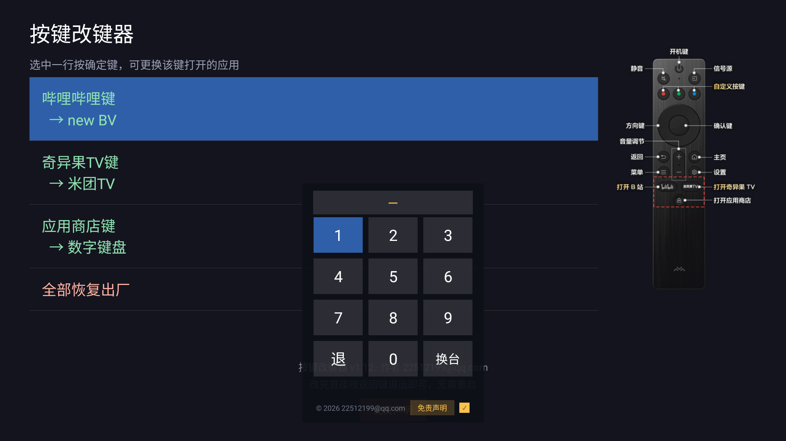
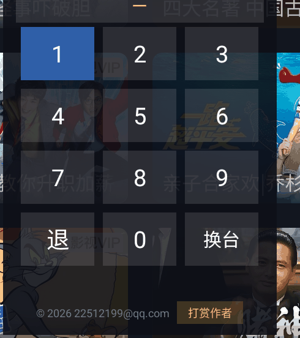
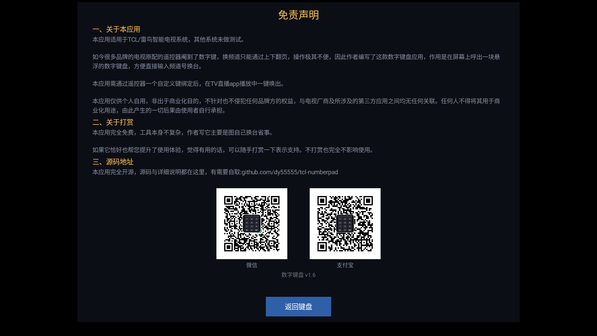
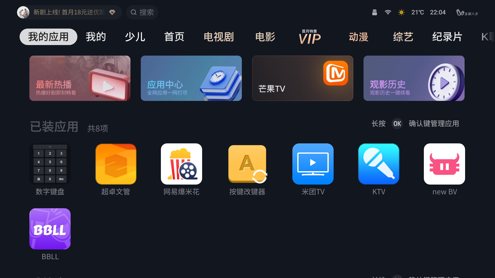
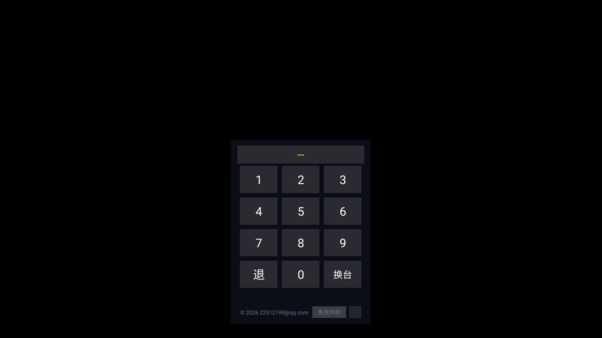
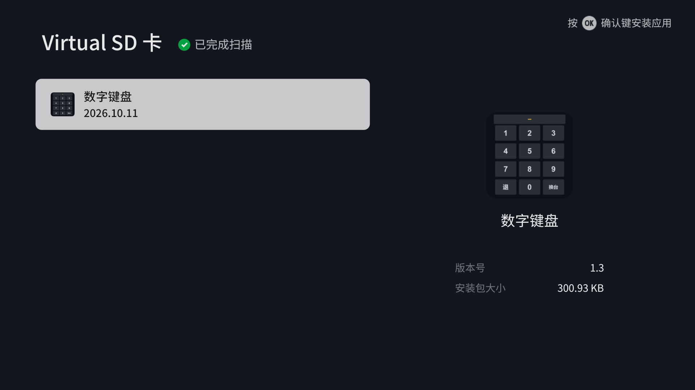

# 数字键盘

给没有数字键的电视遥控器，补上一个数字键盘。

在电视屏幕上弹出一个悬浮键盘，用方向键选数字、按确定输入，输完按「换台」——
键盘会**先把自己关掉**，再把频道号当成真实数字按键注入给当前前台的直播应用。

包名 `com.tclhotkey.floatnum` · 版本 **1.8** · 需要 Android 5.0+
**不用 root，不用刷机，不用换遥控器**，装好之后也不用一直连着电脑。

> **本应用是悬浮窗，不能独立启动。** 需要先用配套的
> [按键改键器](https://github.com/dy55555/tcl-keymapper) 把遥控器上的某个键绑到它，
> 之后按那个键才能呼出。

---

## 它是干嘛的

很多电视的原配遥控器**没有数字键**。看直播想直接跳到 12 台，只能一页页往上翻。

这个工具做的事：**在屏幕上给你一个数字键盘**，输完直接换台。



面板会盖在电视画面上（`TYPE_APPLICATION_OVERLAY`），上下左右选数字、确定键输入，
最底下一行是作者信息和免责声明入口。



> 面板会自己让出焦点，把数字键送给**你正在看的那个直播应用**。
> 所以什么直播软件都能用，不是针对某一个软件做的适配。

免责声明页（**一屏放得完，不需要滚动**；正文版式与按键改键器保持一致）：



> 上图截自 1.7 版。1.8 起三段正文按改键器的版式加大（小标题 19sp / 正文 16sp、
> 行距与段距同步对齐），收款码相应从 152dp 收到 108dp，页面仍是一屏放得完。

### 收款码中间为什么盖着应用图标

两张收款码的**正中间**叠着一个本应用的图标。这不是装饰，是有讲究的：

二维码中间的图案**本身就是编码数据的一部分**，直接去改图片像素会把码改坏。
所以这里的做法是**在界面上叠一层**（`FrameLayout`），不碰图片本身 ——
这样你以后换成自己的收款码，图标照样会自动叠上去。

叠多少是个权衡。实测（opencv 的 `QRCodeDetector`，拿支付宝那张码试）：

| 图标占码面 | 还能不能扫 |
|---|---|
| 20% | 能 |
| 26% | 能 ← **本项目用的值** |
| 32% | 能（已经贴着安全线了） |

**最终是从电视实拍画面里裁下两张码重新解码验证的** —— 叠着图标的情况下，
微信那张解出 `wxp://…`，支付宝那张解出 `https://qr.alipay.com/…`，都正常。

> 顺带一个意外发现：微信那张码**不叠图标时反而解不出来**（中间自带的彩色
> 微信 logo 干扰了识别），叠上带白底衬板的图标之后就好读了。

两张码之间留了 **48dp** 空白（约为码宽的 32%），离上方正文也有 **26dp** ——
挨太近了拿手机扫容易扫到隔壁那张，或者把码和上面的文字一起框进去。

---

## 怎么用

### 第一步：先把它叫出来

这个应用**没有桌面图标，也不能从应用列表直接启动** ——
它在系统里的身份，是给[按键改键器](https://github.com/dy55555/tcl-keymapper)
绑键用的一个「目标」：

1. 电视上打开 **【按键改键器】**；
2. 挑一个你不常用的遥控器键（比如某个快捷键 / 自定义键）；
3. 把它的动作设成 **启动应用 → 数字键盘**；
4. 保存。

之后按那个键，数字键盘就会浮出来。一次绑好，永久有效。



> **为什么不做成能独立启动的？** 因为它本质上是一层「盖在当前画面上的悬浮窗」，
> 必须盖在别的东西上面才成立。独立启动的话，一按返回键它自己就没了 ——
> 由改键器的按键呼出，是唯一合理的入口。

### 第二步：在键盘上操作

| 操作 | 说明 |
|---|---|
| **上下左右** | 移动光标 |
| **确定键** | 输入这个数字 |
| **退** | 删掉一位；号码框空着时按「退」或「返回键」就关掉面板 |
| **换台** | 确认换台 |
| **☑ 勾选框** | 勾上之后「免责声明」按钮才生效；取消勾选按钮变灰、方向键也跳不过去 |
| **免责声明** | 方向键移到那行，按确定翻到声明页 |

比如要看 13 台：按 `1` `3`，再按【换台】。

面板布局：

```
┌─────────────────────────┐
│            —            │  ← 正在输入的频道号
├────────┬────────┬───────┤
│   1    │   2    │   3   │
│   4    │   5    │   6   │
│   7    │   8    │   9   │
│   退   │   0    │  换台 │
├────────┴────────┴───────┤
│ © 2026 …  [ 免责声明 ] ☑ │  ← 勾选框决定按钮是否生效
└─────────────────────────┘
```

### 为什么要加这个勾选框

输完频道号顺手按【换台】，方向键在收尾时很容易滑到「免责声明」上 ——
一按就跳进声明页，还得再按一次返回才能继续。

所以 1.4 起默认**不勾选**，按钮是灰的且**不接受焦点**（方向键直接跳过去），
快速操作时根本碰不到它。想看声明就主动勾一下，看完取消即可。
勾选状态会记在本地，下次开键盘保持你上次的决定。



---

## 换台的完整流程

```
用户按「换台」
  → close() 关掉悬浮窗，把焦点还给直播应用     ← 关键，不关的话按键会打给自己
  → 后台线程 sleep 200ms 等焦点归位
  → AdbShell.sendDigits("12")
       → 把 1、2 翻译成 KEYCODE_1(8)、KEYCODE_2(9)
       → 发给常驻助手：KEYW com.tclhotkey.floatnum 8 9
            → 助手盯着前台焦点，确认已经离开本应用，才动手注入
  → 注入 KEYCODE_1、KEYCODE_2（带真实 scancode）
  → 直播应用收到，换到 12 台
```

### 三级回退

`sendDigits()` 里是一条降级链，任何一级成功就返回：

| 级别 | 走什么路 | 实测耗时 | 说明 |
|---|---|---|---|
| 1 | 常驻助手（本地 socket） | **约 30ms** | 首选。助手已经在跑就用它 |
| 2 | 用 adb 把助手拉起来再试 | 约 1s | 助手没在跑、或者版本不对 |
| 3 | `adb shell input keyevent` | 约 1.3s | 兜底。每条命令要起一个虚拟机，慢，但一定生效 |

> 助手不在时，键盘**一打开就会预热**（`warmUp()`），所以等你输完号码通常已经就绪，
> 按「换台」是瞬间的。只有刚开机、或者电视很久没用时，第一次会多花一两秒。

> 拉起助手失败会**退避 20 秒**，免得每按一次键都白等一整轮。

---

## 三个实测出来的坑

### 1. 注入的按键必须带真实 scancode

直接 `adb shell input keyevent 8` 这种注入，事件的 **scancode 是 0**。

实测很多直播应用（包括本项目验证过的那款）**会忽略 scancode 为 0 的按键**，
认为是合成事件。所以助手走的是底层 `InputManager.injectInputEvent()`，带上真实 scancode，
直播应用才会当成遥控器真的被按了。

> 还有一层：`injectInputEvent` 在 `ASYNC` 模式下**即使事件被系统丢掉也会返回 true**，
> 所以不能拿返回值当成功判据 —— 本项目的做法是让助手验证注入前的焦点状态。

### 2. 助手进程启动的三个细节，缺一不可

原来那条 `cp ... && nohup ... &` 冷启**成功率只有 1/5**；改成现在这样是 **5/5**：

| # | 细节 | 不这么做的后果 |
|---|---|---|
| 1 | `cp` 单独先执行，不和 `nohup` 一起后台化 | 整条 `cp && nohup ... &` 会被当成一个后台任务，而 shell 立刻退出，子进程还没跑到 `nohup` 就被带走了 —— 现象是 `ki.apk` 更新了、但 `ki.log` 根本没生成 |
| 2 | 必须加 &lt;/dev/null&gt;（把标准输入接到空设备） | 否则助手的 stdin 继承自 adb 会话，会话迟迟不关闭，`exec()` 会一直卡着等不到回包 |
| 3 | 结尾 `sleep 1` | 把会话多留一秒，让 `app_process` 站稳再断连 |

另外启动前会**先把占着端口的旧助手杀掉**。老版本助手的注入是坏的，
不杀掉的话新助手起不来（端口被占），会一直用坏的那个。

### 3. 助手要认版本，不能只认「活着」

助手回包带一个版本标记（`OK v2`）。应用**只认带 `v2` 的回包**：

```java
return reply != null && reply.startsWith("OK") && reply.contains("v2");
```

原因是老版本助手的注入是坏的（**报成功但不生效**），必须当成「不可用」处理，
否则会把有效的 `input` 兜底路径给屏蔽掉。

---

## 为什么每台设备要自己生成一把 ADB 私钥

这是本项目里最容易被忽略、但最要紧的一处设计。

应用要往系统里注入按键，唯一的合法路子是**借电视自己的 adb 通道**
（连 `127.0.0.1:5555` 上的 adbd，认证后拿 shell 权限，shell uid 持有 `INJECT_EVENTS`）。

那把用来向 adbd 认证的 RSA 私钥，**曾经是写死在源码里的**。

问题在于：**adbd 一旦开了 TCP 监听，它监听的是整个局域网，不只听 127.0.0.1。**
如果私钥写死在源码里、源码又公开了，那么任何能连上这台电视 5555 端口的人，
只要拿着这把公开的钥匙，就能直接拿到 shell —— 等于把用户的电视交出去。

所以现在的做法（`AdbKey.java`）：

```
第一次运行时现场生成一把 2048 位 RSA 私钥
  → 存到 /data/data/com.tclhotkey.floatnum/files/adbkey.pk8
  → 别的应用读不到（Android 沙箱），也不会跟着源码一起发出去
  → 进程内缓存，第二次用直接返回，不读盘
```

想重新配对（换了电视、或者怀疑钥匙泄露）：把 `files/adbkey.pk8` 删掉即可，
下次会自动生成新的一把，电视上会重新弹一次「允许 USB 调试」。

相关实现（`AdbShell.java`）是**手写的 adb 协议客户端** —— `CNXN` / `AUTH` / `OPEN` /
`OKAY` / `CLSE` / `WRTE` 全部自己拼。两个实测出来的细节：

- 签名不是「对 token 做 SHA1」，而是把 20 字节 token **直接当成 SHA-1 摘要**，
  前面拼 SHA-1 的 DigestInfo 头，再做 PKCS#1 v1.5 填充。
  用 `Signature.getInstance("NONEwithRSA")` 正好就是这个语义；
- **认证是强制的**，跳过直接 `OPEN` 会被 adbd 断连。

---

## 安装

### 1. 装 APK

编译好的安装包就在本仓库里：

| 文件 | 说明 |
|---|---|
| [`tools/数字键盘.apk`](tools/) | 当前版本 1.8，与本仓库源码同源构建（已在电视上实测安装通过） |

> 在 GitHub 文件页右上角点 **Download**（或点 **Raw**）即可下载。

#### 办法一：一键脚本（推荐）

`tools/` 里带了一个 [`一键安装到电视.bat`](tools/一键安装到电视.bat)：

1. **双击它**（或者把 APK 拖到它上面松手）；
2. 输入电视的 IP，回车；
3. 等十几秒，看到「装好了」。

电视和电脑要在同一个 WiFi 里，电视的 ADB 开关要开着（见下面第 2 节）。

> 脚本自己会去找 `adb.exe`：先看自己所在目录，再看系统 PATH，
> 最后翻几个常见的 SDK 安装位置。都没有的话会告诉你去哪儿弄一个。
> 第一次输的 IP 会记在 `tools/.tv-ip.txt` 里，以后直接回车就行。

#### 办法二：U 盘 + 电视界面（不想碰电脑的话）

1. 把 APK 拷到 **U 盘**上，U 盘插到电视；
2. 电视上打开 **【安全卫士】→【应用管理】→【应用安装】**；
3. 它会自动扫描移动存储设备，列出找到的安装包；
4. 光标选中要装的包，**按遥控器 OK 键**；
5. 弹出系统安装确认框 → 选「**安装**」。



#### 为什么 `adb install` 会报 `INSTALL_FAILED_VERIFICATION_FAILURE`？

TCL 固件在安装链路上加了一道**必需校验器**（Required Verifier），
对 shell（也就是 adb 用的那个身份）提交的安装一律拒绝。
**这不是包的问题** —— 换任何一个别的包、乃至应用商店自己下载的包，
走这条命令一样失败。

拦截点就是 `com.android.packageinstaller` 这个包。把它临时停掉，
adb 安装立刻就能过，装完再恢复：

```bash
adb shell pm disable-user --user 0 com.android.packageinstaller
adb install -r -g 数字键盘.apk        # 实测：Success
adb shell pm enable com.android.packageinstaller
```

> 在 TCL 电视（Android 11 / MT9653）上实测：停掉它之后
> **`adb install` 和 `pm install` 两条路都是 Success**；
> 恢复之后包管理器状态正常，不留后遗症。
> 上面那个一键脚本做的就是这三步 —— 并且把「恢复」放在无论成败都会执行的位置，
> 不会把电视留在禁用状态。

### 2. 在电视上打开 ADB 开关（只做一次，永久有效）

> **这个应用不需要电脑，也不需要授权任何签名级权限。**
> 它只是连电视自己的 adbd（`127.0.0.1:5555`），走的是一条**本机内部**的路子。

开关藏起来了，要用特定手势调出来。这一步是**最费耐心的**，慢慢来：

1. 打开电视的【设置】→ 左侧那一列里找到**最下面那个 ⓘ 图标的「关于」**；
2. 进「关于」→ 找到**【本机信息】**，把光标**停在**这一行上，**先不要按确定键**；
3. 依次按遥控器：**上 → 下 → 左 → 右**（一个一个按，不是同时按）。

按完 ADB 开关就会冒出来。把它打开，**电视会自动重启一次** —— 这是正常的。

> 这个开关**只需要开一次**，以后重启电视、升级应用都不会失效。
> 只有「恢复出厂设置」会清掉，需要重做。

判断开关真的开了没有，看两条：

```bash
adb connect <电视IP>:5555     # 能连上
adb shell netstat -an | grep 5555   # 应该看到 :::5555  LISTEN
```

### 3. 第一次按「换台」时，电视会问你一句 —— 点「允许」

**电视屏幕上会弹出**：

> 是否允许 USB 调试？
> 这台计算机的 RSA 密钥指纹为：……

看到这个弹窗**说明一切正常**。勾上「**一律允许使用这台计算机进行调试**」，再选「**允许**」。

**弹窗只出现这一遍**，之后永远不再问。

> 没看到弹窗、按了「换台」也没反应？多半是 ADB 开关没真正打开
> （判断标准：打开时电视**重启过**一次）。

---

## 源码

5 个 Java 文件，全在 `java/com/tclhotkey/floatnum/`：

| 文件 | 作用 |
|---|---|
| `KeyboardActivity.java` | **悬浮键盘本体**：布局、按键处理、换台流程、免责声明页、按钮勾选开关 |
| `AdbShell.java` | **核心**：手写 adb 协议客户端 + 助手进程的拉起/通信 + 三级回退 |
| `AdbKey.java` | 本机 adb 私钥：第一次运行时现生成一把，存应用私有目录 |
| `KeyInject.java` | **助手进程**：用 `app_process` 跑在 shell 身份下，真正执行按键注入 |
| `ChannelApi.java` | 备用通道：注入失败时退回直播应用自己的本机换台接口 |

### 助手是怎么跑起来的

```
应用（普通 app 身份）
  → AdbShell 连 127.0.0.1:5555 的 adbd，RSA 认证，拿到 shell
  → cp 自己的 apk 到 /data/local/tmp/ki.apk   ← 当 classpath 用
  → nohup app_process -Djava.class.path=/data/local/tmp/ki.apk /system/bin \
        --nice-name=ki com.tclhotkey.floatnum.KeyInject
  → 助手以 shell uid 跑起来，监听 127.0.0.1:38300
  → 应用用本地 socket 跟它说话：PING / KEYW <排除包名> <键码...>
```

助手之所以能注入，是因为 **shell uid 持有 `INJECT_EVENTS` 权限**，普通 app 拿不到。

### ChannelApi 是什么

电视自己提供了一个本机换台接口：`127.0.0.1:29191` 上跑着一个
「电视大全局域网播放控制系统」，里面有 `playEname`（按频道号换台）。
app 访问自己的 localhost 不需要任何权限，也不经过网络。

这是**兜底通道** —— 它的缺点是只对适配了这套接口的机型有效，所以不用它当主路径。
（那个接口的 `/ykq` 能触发遥控器按键，但**没有数字键**，数字只能走 `playEname` 换频道。）

> 清单里声明 `INTERNET` 权限就是为了这个 —— 走 localhost，不实际联网。

### 图标

1.3 版起有一枚定制图标：**深色底板 + 白灰九宫格 + 琥珀色显示条**，
就是把真正的键盘面板缩小成一个图标。


三处关键尺寸（都是跟电视桌面实测对齐过的）：

| 项 | 取值 | 为什么 |
|---|---|---|
| 键盘占画布 | 94% | 电视桌面的图标槽位四周留白很小，画太满会被切边，画太小会显得比别人小一圈 |
| 底板圆角 | 画布宽的 12.5% | 跟系统图标的圆角规律一致 |
| 键块圆角 | 6px（512 画布） | 放大到 108~432px 五档都还能看出是圆角，又不会糊成圆形 |
| 显示条与键阵对齐 | 左右各 0px 差 | 显示条宽 = 3 键宽 + 2 内部间隙 = 键阵外缘总宽；1.8 修掉了"从内容区左缘起画"导致的整条左移 5dp |

五档 mipmap 全部由同一张 512 画布用 LANCZOS 缩放生成，保证小尺寸下不出现锯齿。
想自己改配色/尺寸，改 [`tools/make-icon.py`](tools/make-icon.py) 顶部的常量重跑即可：

```bash
pip install pillow numpy
python tools/make-icon.py           # 直接写进 res/mipmap-*/
python tools/make-icon.py --preview # 顺带存一张 512 预览图
```

脚本每次都会自检**四角必须透明** —— 不透明的话电视桌面会把图标显示成一块黑方块。

---

## 常见问题

**`adb install` 报 `INSTALL_FAILED_VERIFICATION_FAILURE`？**
不是包的问题，是电视固件拦了 adb 这条安装通道。走电视界面里的
**【安全卫士】→【应用管理】→【应用安装】**（或应用市场的 U 盘安装入口）就能装上，
详见上面[「装 APK」](#1-装-apk)一节。

**装好了，但找不到桌面图标 / 点不开？**
这是正常的 —— 它**没有桌面图标**，也不能独立启动。
必须先用按键改键器把遥控器某个键绑到它，按那个键呼出。见[「先把它叫出来」](#第一步先把它叫出来)。

**按了「换台」没反应？**
先看那个「允许 USB 调试」的弹窗有没有答应过。没答应过就没权限，重装一次再试。
再确认 ADB 开关是真开了（打开时电视会重启）。

**第一次按「换台」感觉慢？**
正常。键盘一打开就在后台准备助手了，通常等你输完号码就已经就绪。
只有刚开机或电视很久没用时第一次会多花一两秒。**如果每次都慢**，
多半是调试授权没答应，重做一遍。

**按了超过频道总数的号（比如一共 337 个台，按了 700）？**
电视自己的直播软件会去处理这个号码，一般会跳回上一个频道。
这是直播软件的行为，不是键盘的问题。

**支持我的电视吗？**
只要是**安卓系统**的电视，理论上都行 —— 但要先过 ADB 开关那一关。
同一品牌/型号成功率最高。

**会影响电视原来的功能吗？**
不会。数字键盘只在你自己打开它的时候才工作，不碰遥控器上任何一个原生按键。

---

## 自己编译

不依赖 Gradle，也不需要完整的 Android SDK：

```bash
./build.sh
# 产物：build/app.apk
```

脚本自己会做的事：

```
源码搬到纯 ASCII 临时目录
  → aapt2 编译资源
  → aapt2 link 出 base.apk，同时生成 R.java
  → ECJ 编译 java（含 R.java）→ .class
  → d8 把 .class 转成 classes.dex
  → 把 dex 塞回 APK
  → apksigner 签名
```

**为什么要先搬到临时目录**：`aapt2` / `apksigner` 是 Windows 程序，路径里带中文就直接报
`failed to open directory: 系统找不到指定的文件`。所以这棵源码树可以放在任何位置
（哪怕目录名是中文），脚本会自己搬到一个纯 ASCII 的临时目录去编。

### 工具链在哪

脚本按**三档**找每一件工具，谁先命中用谁：

| 优先级 | 来源 | 怎么用 |
|---|---|---|
| 1 | 环境变量 | `ECJ=/path/to/ecj.jar ./build.sh`，或一次性全设好 |
| 2 | 仓库根的 `toolchain/` | 把文件扁平放进去即可，脚本按名字认 |
| 3 | 标准 Android SDK | 设 `ANDROID_SDK`，脚本自己在 `build-tools/` 和 `platforms/` 里找 |

任一件找不到，脚本会一次性告诉你缺哪些、怎么给，不会编到一半才失败。

### 工具链

需要 5 个文件，它们**都不随本仓库分发**（体积大 + 各有各的授权协议）：

| 文件 | 是什么 | 从哪来 |
|---|---|---|
| `aapt2.exe` | 资源编译器 | Android SDK 的 `build-tools/<版本>/` |
| `d8.jar` | class → dex | Android SDK 的 `build-tools/<版本>/lib/` |
| `apksigner.jar` | APK 签名 | Android SDK 的 `build-tools/<版本>/lib/` |
| `android.jar` | 编译期的 Android 平台库 | Android SDK 的 `platforms/android-<API>/` |
| `ecj-3.26.0.jar` | Eclipse Java 编译器 | <https://repo1.maven.org/maven2/org/eclipse/jdt/ecj/> |

**已经有 Android SDK 的话什么都不用准备**，让脚本能找到就行：

```bash
export ANDROID_SDK=/path/to/Android/Sdk
./build.sh
```

否则就在仓库根建一个 `toolchain/` 目录，把上面 5 个文件扁平放进去，脚本会自己按名字找
（这个目录已在 .gitignore 里，不会进仓库）。

单独指定某一件用环境变量，按上面表格里的名字：

```bash
JAVA=/path/to/java ECJ=/path/to/ecj.jar ./build.sh
```

可用的环境变量：`ANDROID_SDK` `ANDROID_PLATFORM` `JAVA` `JAVA_HOME`
`AAPT2` `D8JAR` `APKSIGNER` `ANDROIDJAR` `ECJ`

> **关于 ecj**：用它而不是 `javac`，是因为 `javac` 从 JDK 9 起就不再支持
> `-bootclasspath` 了，而编译 Android 的 class 必须把 `android.jar` 当 bootclasspath 用。
> `ecj` 一直支持，而且单独一个 jar、只需要 JRE 就能跑。

> **关于签名**：仓库里带了一份 `debug.keystore`（**调试用，密码就是 `android`**，
> 别名 `hotkey`）。想用自己的密钥就替换它，同时改 `build.sh` 底部那几行。
> **要正式分发的话请另外生成一把发布密钥。**

---

### ⚠️ 关于收款码

仓库里 `res/drawable/qr_wechat.png` 和 `res/drawable/qr_alipay.png` 放的是**网上公开的示例码**，
不是某个人的真实收款码（实测解码：微信那张是 `wxp://…` 演示串，
支付宝那张是 `https://qr.alipay.com/fkx10208fh4wdhbovzfjla2` 官方文档里的演示码）。

也就是说：**现在打赏会打给演示码对应的那个演示收款账户**，别指望能收到钱。

要用自己的：把两张图换成自己生成的收款码，文件名保持不变，重新 `./build.sh` 即可，
不用改任何代码。放不进去的话，声明页会自动降级成一行提示文字，不会崩。

---

## 授权与声明

- 代码以 **MIT 许可证** 发布，见 [LICENSE](LICENSE)。
- 本项目是**个人自用工具**，**非商业化目的**，与任何电视/机顶盒品牌方**没有关联**，
  也未获得其授权或赞助；请勿将本项目用于商业用途。
- 项目里出现的应用名、商标、图标等归各自权利人所有，此处仅用于说明兼容性和操作路径。
- 本软件按「现状」提供，**不提供任何担保**。

**风险提示**：它做的事就是模拟你按遥控器上的数字键，跟换一个遥控器是一个性质 ——
不动电视系统、不刷机、不改任何系统文件，卸载之后电视上不留任何东西。
但按键注入这类操作仍然请你自行判断、自行承担风险。

作者：`22512199@qq.com`

---

如果这个小工具恰好也解决了你的问题，欢迎点个 Star。
